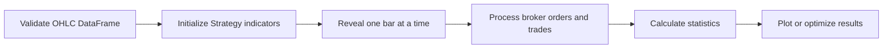
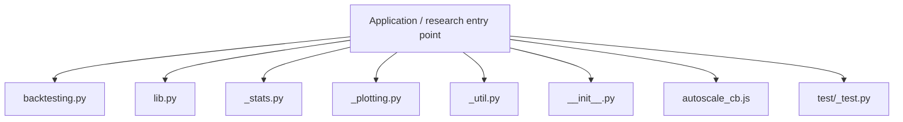
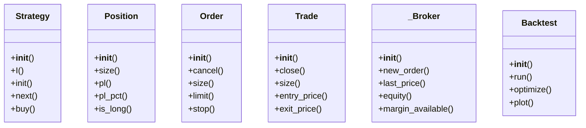
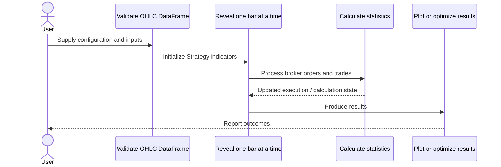
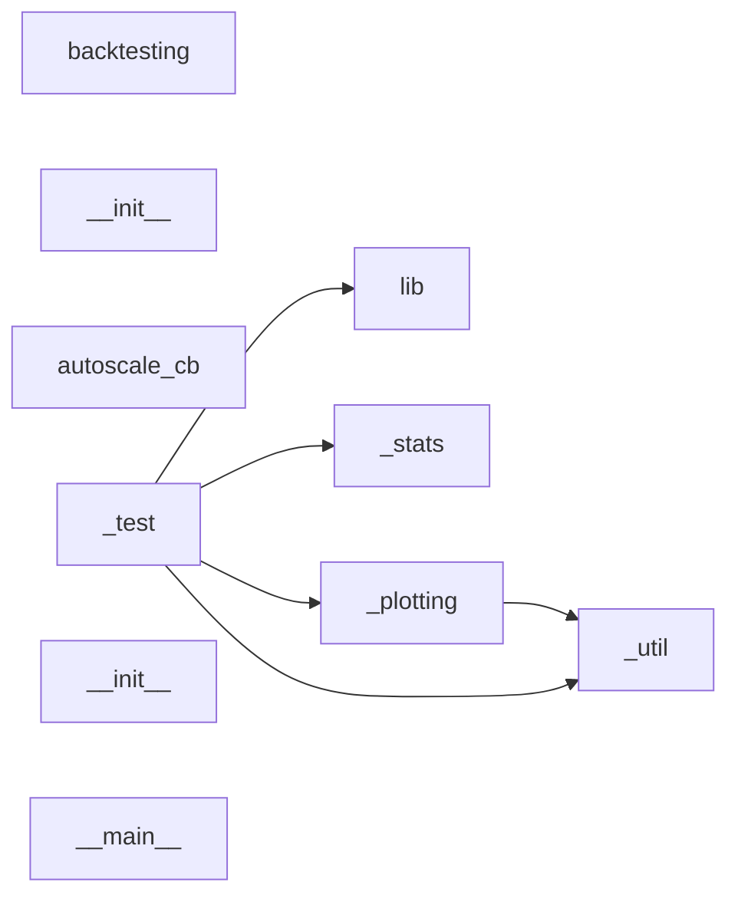
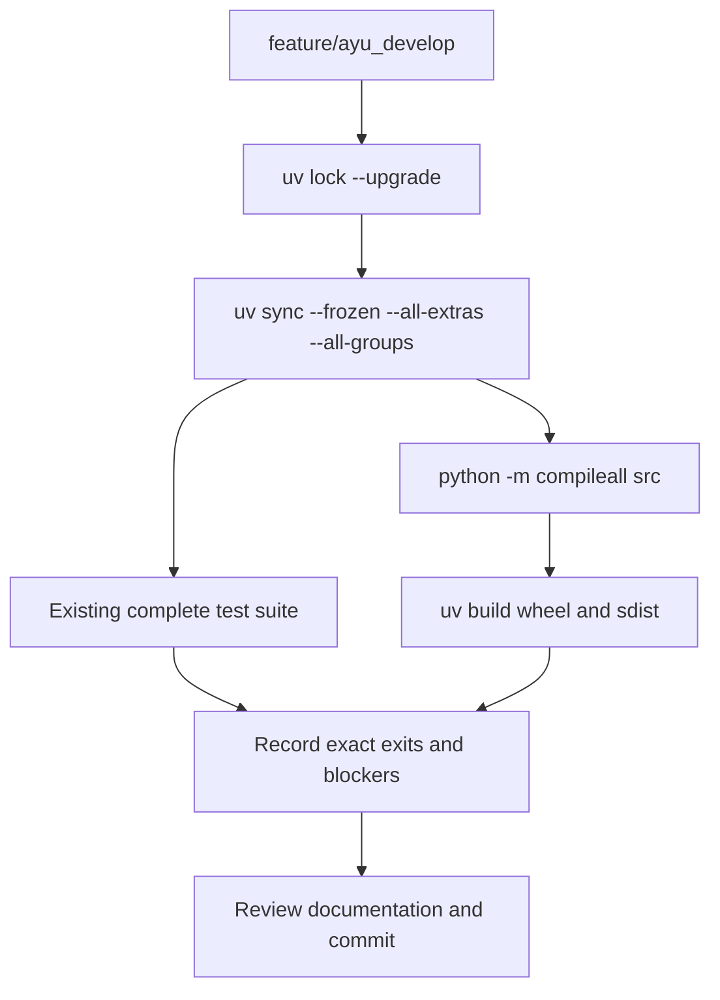

# backtesting.py: development, architecture and operations

Updated 2026-10-12 on `feature/ayu_develop`; source snapshot `8836111832c9`. This guide follows the source in this checkout and separates available interfaces from verification evidence.

## Purpose and feature boundaries

OHLC-based strategy simulation, parameter optimization, performance statistics and interactive Bokeh reports, centered on Backtest and Strategy.

Strategy.init precomputes indicators and Strategy.next observes progressively revealed history. The broker owns orders and fills; statistics and plotting consume finished trade/equity records. Optimization runs many independent strategy instances. The existing unittest entry point, including package test data, is the authoritative suite.

## Main workflow

The following is the repository-specific logical workflow. Runtime execution details remain in the linked source and the validation record.

1. Validate OHLC DataFrame.
2. Initialize Strategy indicators.
3. Reveal one bar at a time.
4. Process broker orders and trades.
5. Calculate statistics.
6. Plot or optimize results.

## Components and ownership

The entry point composes the source modules below; arrows indicate review/navigation boundaries rather than a claim that every module is called in every run.

| Source | Declared classes / functions | Implementation role |
|---|---|---|
| [src/backtesting/backtesting.py](../src/backtesting/backtesting.py) | Strategy, Position, _OutOfMoneyError, Order, Trade, _Broker | Core framework data structures. |
| [src/backtesting/lib.py](../src/backtesting/lib.py) | SignalStrategy, TrailingStrategy, FractionalBacktest, MultiBacktest; barssince, cross, crossover, plot_heatmaps | Collection of common building blocks, helper auxiliary functions and |
| [src/backtesting/_stats.py](../src/backtesting/_stats.py) | _Stats; compute_drawdown_duration_peaks, geometric_mean, compute_stats, dummy_stats | See the public declarations and implementation linked here. |
| [src/backtesting/_plotting.py](../src/backtesting/_plotting.py) | set_bokeh_output, _windos_safe_filename, _bokeh_reset, _add_popcon | See the public declarations and implementation linked here. |
| [src/backtesting/_util.py](../src/backtesting/_util.py) | _Array, _Indicator, _Data, SharedMemoryManager; try_, patch, _as_str, _as_list | See the public declarations and implementation linked here. |
| [src/backtesting/__init__.py](../src/backtesting/__init__.py) | Pool | {: height=263} |
| [src/backtesting/autoscale_cb.js](../src/backtesting/autoscale_cb.js) | Package data / configuration | See the public declarations and implementation linked here. |
| [src/backtesting/test/_test.py](../src/backtesting/test/_test.py) | SmaCross, _S, TestBacktest, TestStrategy, TestOptimize, TestPlot; _tempfile, chdir | See the public declarations and implementation linked here. |
| [src/backtesting/test/__init__.py](../src/backtesting/test/__init__.py) | _read_file, SMA | Data and utilities for testing. |
| [src/backtesting/test/__main__.py](../src/backtesting/test/__main__.py) | Package data / configuration | See the public declarations and implementation linked here. |
| [src/backtesting/test/GOOG.csv](../src/backtesting/test/GOOG.csv) | Package data / configuration | See the public declarations and implementation linked here. |
| [pyproject.toml](../pyproject.toml) | Package data / configuration | See the public declarations and implementation linked here. |

## Class design

Methods and inheritance edges are taken from the selected declarations in the actual source. A missing edge means composition or an external base is not asserted here.

## End-to-end interaction

This sequence presents the responsibilities of the main workflow, including the state/result boundary. The linked classes and functions provide the exact method-level contract.

## Source dependency direction

These edges are actual explicit imports between the selected source modules. Dynamic imports, re-exports and third-party internals are omitted.

## Design details and extension points

### `Strategy`

Source: [src/backtesting/backtesting.py](../src/backtesting/backtesting.py).

A trading strategy base class. Extend this class and
override methods
`backtesting.backtesting.Strategy.init` and
`backtesting.backtesting.Strategy.next` to define
your own strategy.

- `I`: Declare an indicator. An indicator is just an array of values (or a tuple of such arrays in case of, e.g., MACD indicator), but one that is revealed gradually in `backtesting.backtesting.Strategy.next` much like `backtesting.backtesting.Strategy.data` is. Returns `np.ndarray` of indicator values.
- `init`: Initialize the strategy. Override this method. Declare indicators (with `backtesting.backtesting.Strategy.I`). Precompute what needs to be precomputed or can be precomputed in a vectorized fashion before the strategy starts.
- `next`: Main strategy runtime method, called as each new `backtesting.backtesting.Strategy.data` instance (row; full candlestick bar) becomes available. This is the main method where strategy decisions upon data precomputed in `backtesting.backtesting.Strategy.init` take place.
- `buy`: Place a new long order and return it. For explanation of parameters, see `Order` and its properties. Unless you're running `Backtest(..., trade_on_close=True)`, market orders are filled on next bar's open, whereas other order types (limit, stop-limit, stop-market) are filled when the respective cond
- `sell`: Place a new short order and return it. For explanation of parameters, see `Order` and its properties.

### `Position`

Source: [src/backtesting/backtesting.py](../src/backtesting/backtesting.py).

Currently held asset position, available as
`backtesting.backtesting.Strategy.position` within
`backtesting.backtesting.Strategy.next`.
Can be used in boolean contexts, e.g.

- `size`: Position size in units of asset. Negative if position is short.
- `pl`: Profit (positive) or loss (negative) of the current position in cash units.
- `pl_pct`: Profit (positive) or loss (negative) of the current position in percent.
- `is_long`: True if the position is long (position size is positive).
- `is_short`: True if the position is short (position size is negative).

### `Order`

Source: [src/backtesting/backtesting.py](../src/backtesting/backtesting.py).

Place new orders through `Strategy.buy()` and `Strategy.sell()`.
Query existing orders through `Strategy.orders`.

- `cancel`: Cancel the order.
- `size`: Order size (negative for short orders).
- `limit`: Order limit price for [limit orders], or None for [market orders], which are filled at next available price.
- `stop`: Order stop price for [stop-limit/stop-market][_] order, otherwise None if no stop was set, or the stop price has already been hit.
- `sl`: A stop-loss price at which, if set, a new contingent stop-market order will be placed upon the `Trade` following this order's execution. See also `Trade.sl`.

### `Trade`

Source: [src/backtesting/backtesting.py](../src/backtesting/backtesting.py).

When an `Order` is filled, it results in an active `Trade`.
Find active trades in `Strategy.trades` and closed, settled trades in `Strategy.closed_trades`.

- `close`: Place new `Order` to close `portion` of the trade at next market price.
- `size`: Trade size (volume; negative for short trades).
- `entry_price`: Trade entry price.
- `exit_price`: Trade exit price (or None if the trade is still active).
- `entry_bar`: Candlestick bar index of when the trade was entered.

### `_Broker`

Source: [src/backtesting/backtesting.py](../src/backtesting/backtesting.py).

The class contract is defined by its linked implementation.

- `new_order`: Argument size indicates whether the order is long or short
- `last_price`: Price at the last (current) close.
- `equity`: See implementation for the complete contract.
- `margin_available`: See implementation for the complete contract.
- `next`: See implementation for the complete contract.

### `Backtest`

Source: [src/backtesting/backtesting.py](../src/backtesting/backtesting.py).

Backtest a particular (parameterized) strategy
on particular data.

- `run`: Run the backtest. Returns `pd.Series` with results and statistics.
- `optimize`: Optimize strategy parameters to an optimal combination. Returns result `pd.Series` of the best run.
- `plot`: Plot the progression of the last backtest run.

## Repository layout and resources

Installable packages live under `src/`. `pyproject.toml` defines package metadata, build requirements, optional integrations and development dependencies; `uv.lock` records resolved versions, and `.python-version` selects the local interpreter. This layout keeps an accidental checkout import from substituting for the installed wheel. Package resources remain beside their owning modules and are included by the build backend. Existing upstream examples, fixtures, scripts and documentation retain their separate roles.

## Maintenance compatibility and evidence

- The existing package unittest suite is authoritative; the README lookup was adjusted for src layout. Package CSV and JavaScript resources remain beside the package.
- Python 3.15 is supported after allowing the current PyYAML release to build from source; absence of a wheel alone was not treated as an incompatibility.

## Development and verification workflow

See [development commands](development.md) and [validation evidence](validation.md) for interpreter selection, dependency exceptions, full-suite results and remaining blockers. No additional test cases were introduced by this maintenance.
