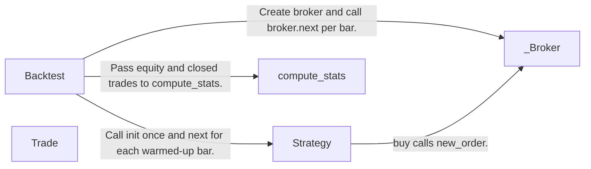
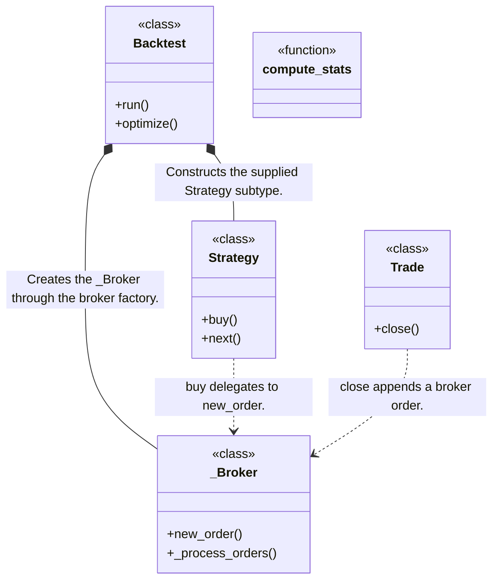
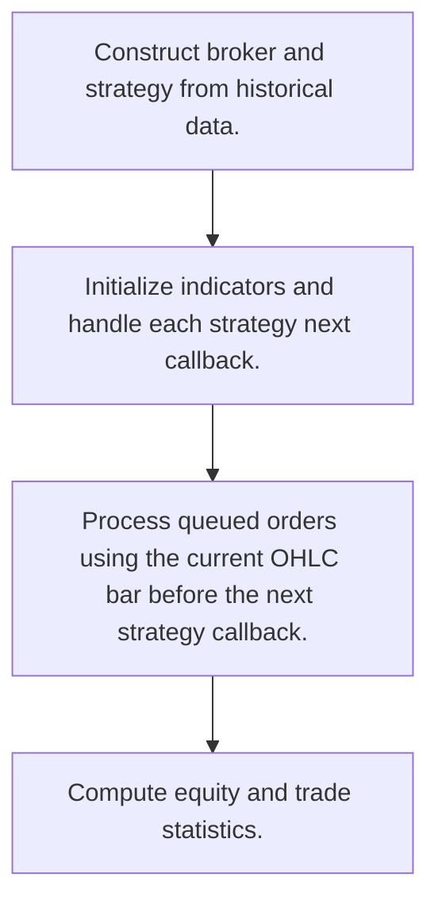
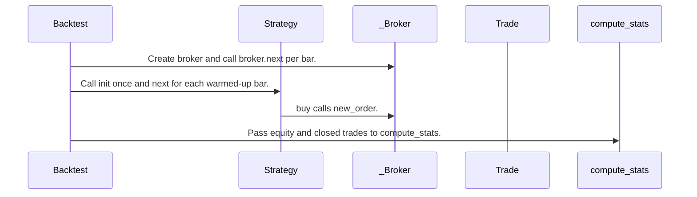

# Backtesting.py: workflow, design and architecture

Updated: **2026-10-13**
Reviewed Git hash: `776774382657a6192d32f1030f9eaf8f0d9936e8`
Branch: `feature/ayu_develop`
Source diff SHA256: `e3b0c44298fc1c149afbf4c8996fb92427ae41e4649b934ca495991b7852b855`
Scope: **Bar-based backtesting engine** / Maintenance: **active**
Languages: Python

[HTML edition](ayu-develop.html) / [Development](development.md) / [Historical validation](validation.md) / [Full system comparison](../../docs/index.html)

## Purpose and scope

Simulate a strategy on one OHLCV data frame with order and trade accounting, optimization, and performance statistics.

## Features and support boundaries

Native = implemented here. Integration = supplied through a named host/API. Limited = material restriction. Not provided = evidenced scope exclusion. Unverified = support/absence not established. Not applicable = outside this artifact type.

| Capability | Status | Implementation and limits | Source |
|---|---|---|---|
| Backtesting | Native | Bar-by-bar OHLC simulation with broker processing before strategy callback. | [Backtest.run](../src/backtesting/backtesting.py) ([L1271](https://github.com/alexcwyu/backtesting.py/blob/776774382657a6192d32f1030f9eaf8f0d9936e8/src/backtesting/backtesting.py#L1271)) / [Backtest.optimize](../src/backtesting/backtesting.py) ([L1386](https://github.com/alexcwyu/backtesting.py/blob/776774382657a6192d32f1030f9eaf8f0d9936e8/src/backtesting/backtesting.py#L1386)) |
| Live execution | Unverified | The inspected source does not establish this capability. This is not a claim of absence. | Not applicable to this repository scope. |
| Paper trading | Unverified | The inspected source does not establish this capability. This is not a claim of absence. | Not applicable to this repository scope. |
| Event driven | Limited | Sequential bar callbacks rather than an asynchronous event bus. | [Backtest.run](../src/backtesting/backtesting.py) ([L1271](https://github.com/alexcwyu/backtesting.py/blob/776774382657a6192d32f1030f9eaf8f0d9936e8/src/backtesting/backtesting.py#L1271)) / [Backtest.optimize](../src/backtesting/backtesting.py) ([L1386](https://github.com/alexcwyu/backtesting.py/blob/776774382657a6192d32f1030f9eaf8f0d9936e8/src/backtesting/backtesting.py#L1386)) |
| Vectorized | Limited | Indicators and statistics may use arrays. Order execution remains a bar loop. | [Backtest.run](../src/backtesting/backtesting.py) ([L1271](https://github.com/alexcwyu/backtesting.py/blob/776774382657a6192d32f1030f9eaf8f0d9936e8/src/backtesting/backtesting.py#L1271)) / [Backtest.optimize](../src/backtesting/backtesting.py) ([L1386](https://github.com/alexcwyu/backtesting.py/blob/776774382657a6192d32f1030f9eaf8f0d9936e8/src/backtesting/backtesting.py#L1386)) |
| Order management | Native | Queued orders and trades, exclusive order handling and partial trade close. | [_Broker.new_order](../src/backtesting/backtesting.py) ([L765](https://github.com/alexcwyu/backtesting.py/blob/776774382657a6192d32f1030f9eaf8f0d9936e8/src/backtesting/backtesting.py#L765)) / [_Broker._process_orders](../src/backtesting/backtesting.py) ([L875](https://github.com/alexcwyu/backtesting.py/blob/776774382657a6192d32f1030f9eaf8f0d9936e8/src/backtesting/backtesting.py#L875)) / [Trade.close](../src/backtesting/backtesting.py) ([L573](https://github.com/alexcwyu/backtesting.py/blob/776774382657a6192d32f1030f9eaf8f0d9936e8/src/backtesting/backtesting.py#L573)) |
| Order types | Native | Market, limit, stop, stop-limit and contingent SL/TP are handled by the broker. | [_Broker.new_order](../src/backtesting/backtesting.py) ([L765](https://github.com/alexcwyu/backtesting.py/blob/776774382657a6192d32f1030f9eaf8f0d9936e8/src/backtesting/backtesting.py#L765)) / [_Broker._process_orders](../src/backtesting/backtesting.py) ([L875](https://github.com/alexcwyu/backtesting.py/blob/776774382657a6192d32f1030f9eaf8f0d9936e8/src/backtesting/backtesting.py#L875)) |
| Multi venue | Unverified | The inspected source does not establish this capability. This is not a claim of absence. | Not applicable to this repository scope. |
| Crypto | Unverified | The inspected source does not establish this capability. This is not a claim of absence. | Not applicable to this repository scope. |
| Equities | Unverified | The inspected source does not establish this capability. This is not a claim of absence. | Not applicable to this repository scope. |
| Futures | Unverified | The inspected source does not establish this capability. This is not a claim of absence. | Not applicable to this repository scope. |
| Options | Unverified | The inspected source does not establish this capability. This is not a claim of absence. | Not applicable to this repository scope. |
| Forex | Unverified | The inspected source does not establish this capability. This is not a claim of absence. | Not applicable to this repository scope. |
| Strategy api | Native | Strategy subclasses implement init and next, and submit buy/sell orders. | [Backtest.run](../src/backtesting/backtesting.py) ([L1271](https://github.com/alexcwyu/backtesting.py/blob/776774382657a6192d32f1030f9eaf8f0d9936e8/src/backtesting/backtesting.py#L1271)) / [Backtest.optimize](../src/backtesting/backtesting.py) ([L1386](https://github.com/alexcwyu/backtesting.py/blob/776774382657a6192d32f1030f9eaf8f0d9936e8/src/backtesting/backtesting.py#L1386)) / [Strategy.buy](../src/backtesting/backtesting.py) ([L219](https://github.com/alexcwyu/backtesting.py/blob/776774382657a6192d32f1030f9eaf8f0d9936e8/src/backtesting/backtesting.py#L219)) / [Strategy.next](../src/backtesting/backtesting.py) ([L200](https://github.com/alexcwyu/backtesting.py/blob/776774382657a6192d32f1030f9eaf8f0d9936e8/src/backtesting/backtesting.py#L200)) |
| Optimization | Native | Grid/SAMBO search supports a result-field or callable objective and constraints. | [Backtest.run](../src/backtesting/backtesting.py) ([L1271](https://github.com/alexcwyu/backtesting.py/blob/776774382657a6192d32f1030f9eaf8f0d9936e8/src/backtesting/backtesting.py#L1271)) / [Backtest.optimize](../src/backtesting/backtesting.py) ([L1386](https://github.com/alexcwyu/backtesting.py/blob/776774382657a6192d32f1030f9eaf8f0d9936e8/src/backtesting/backtesting.py#L1386)) |
| Machine learning | Unverified | The inspected source does not establish this capability. This is not a claim of absence. | Not applicable to this repository scope. |
| Reinforcement learning | Unverified | The inspected source does not establish this capability. This is not a claim of absence. | Not applicable to this repository scope. |
| Portfolio | Limited | Cash and trades for a single OHLC data frame. Not a multi-venue portfolio OMS. | [Backtest.run](../src/backtesting/backtesting.py) ([L1271](https://github.com/alexcwyu/backtesting.py/blob/776774382657a6192d32f1030f9eaf8f0d9936e8/src/backtesting/backtesting.py#L1271)) / [Backtest.optimize](../src/backtesting/backtesting.py) ([L1386](https://github.com/alexcwyu/backtesting.py/blob/776774382657a6192d32f1030f9eaf8f0d9936e8/src/backtesting/backtesting.py#L1386)) / [_Broker.new_order](../src/backtesting/backtesting.py) ([L765](https://github.com/alexcwyu/backtesting.py/blob/776774382657a6192d32f1030f9eaf8f0d9936e8/src/backtesting/backtesting.py#L765)) / [_Broker._process_orders](../src/backtesting/backtesting.py) ([L875](https://github.com/alexcwyu/backtesting.py/blob/776774382657a6192d32f1030f9eaf8f0d9936e8/src/backtesting/backtesting.py#L875)) |
| Risk management | Native | Margin checks and SL/TP order construction. Intrabar price ordering remains approximate. | [_Broker.new_order](../src/backtesting/backtesting.py) ([L765](https://github.com/alexcwyu/backtesting.py/blob/776774382657a6192d32f1030f9eaf8f0d9936e8/src/backtesting/backtesting.py#L765)) / [_Broker._process_orders](../src/backtesting/backtesting.py) ([L875](https://github.com/alexcwyu/backtesting.py/blob/776774382657a6192d32f1030f9eaf8f0d9936e8/src/backtesting/backtesting.py#L875)) |
| Performance analytics | Native | Equity/trade metrics and drawdown statistics. | [compute_stats](../src/backtesting/_stats.py) ([L37](https://github.com/alexcwyu/backtesting.py/blob/776774382657a6192d32f1030f9eaf8f0d9936e8/src/backtesting/_stats.py#L37)) |
| Historical data | Limited | Caller supplies a pandas OHLCV frame, validated by Backtest. Provider ingestion is outside this inspected flow. | [Backtest.run](../src/backtesting/backtesting.py) ([L1271](https://github.com/alexcwyu/backtesting.py/blob/776774382657a6192d32f1030f9eaf8f0d9936e8/src/backtesting/backtesting.py#L1271)) / [Backtest.optimize](../src/backtesting/backtesting.py) ([L1386](https://github.com/alexcwyu/backtesting.py/blob/776774382657a6192d32f1030f9eaf8f0d9936e8/src/backtesting/backtesting.py#L1386)) |
| Streaming data | Unverified | The inspected source does not establish this capability. This is not a claim of absence. | Not applicable to this repository scope. |
| Persistence | Unverified | The inspected source does not establish this capability. This is not a claim of absence. | Not applicable to this repository scope. |
| Data pipeline | Unverified | The inspected source does not establish this capability. This is not a claim of absence. | Not applicable to this repository scope. |
| Web ui | Unverified | The inspected source does not establish this capability. This is not a claim of absence. | Not applicable to this repository scope. |
| Cli | Unverified | The inspected source does not establish this capability. This is not a claim of absence. | Not applicable to this repository scope. |
| Monitoring | Unverified | The inspected source does not establish this capability. This is not a claim of absence. | Not applicable to this repository scope. |
| Extension api | Native | Strategy callbacks and custom indicator functions. | [Backtest.run](../src/backtesting/backtesting.py) ([L1271](https://github.com/alexcwyu/backtesting.py/blob/776774382657a6192d32f1030f9eaf8f0d9936e8/src/backtesting/backtesting.py#L1271)) / [Backtest.optimize](../src/backtesting/backtesting.py) ([L1386](https://github.com/alexcwyu/backtesting.py/blob/776774382657a6192d32f1030f9eaf8f0d9936e8/src/backtesting/backtesting.py#L1386)) / [Strategy.buy](../src/backtesting/backtesting.py) ([L219](https://github.com/alexcwyu/backtesting.py/blob/776774382657a6192d32f1030f9eaf8f0d9936e8/src/backtesting/backtesting.py#L219)) / [Strategy.next](../src/backtesting/backtesting.py) ([L200](https://github.com/alexcwyu/backtesting.py/blob/776774382657a6192d32f1030f9eaf8f0d9936e8/src/backtesting/backtesting.py#L200)) |
| Native acceleration | Unverified | The inspected source does not establish this capability. This is not a claim of absence. | Not applicable to this repository scope. |
| Distributed execution | Unverified | The inspected source does not establish this capability. This is not a claim of absence. | Not applicable to this repository scope. |

## System components

| Component | Responsibility | Source |
|---|---|---|
| Backtest | Owns data validation, simulation lifecycle and parameter search. | [Backtest.run](../src/backtesting/backtesting.py) ([L1271](https://github.com/alexcwyu/backtesting.py/blob/776774382657a6192d32f1030f9eaf8f0d9936e8/src/backtesting/backtesting.py#L1271)) / [Backtest.optimize](../src/backtesting/backtesting.py) ([L1386](https://github.com/alexcwyu/backtesting.py/blob/776774382657a6192d32f1030f9eaf8f0d9936e8/src/backtesting/backtesting.py#L1386)) |
| Strategy | User strategy hooks and broker-facing order submission. | [Strategy.buy](../src/backtesting/backtesting.py) ([L219](https://github.com/alexcwyu/backtesting.py/blob/776774382657a6192d32f1030f9eaf8f0d9936e8/src/backtesting/backtesting.py#L219)) / [Strategy.next](../src/backtesting/backtesting.py) ([L200](https://github.com/alexcwyu/backtesting.py/blob/776774382657a6192d32f1030f9eaf8f0d9936e8/src/backtesting/backtesting.py#L200)) |
| _Broker | Simulated order execution, margin and position accounting. | [_Broker.new_order](../src/backtesting/backtesting.py) ([L765](https://github.com/alexcwyu/backtesting.py/blob/776774382657a6192d32f1030f9eaf8f0d9936e8/src/backtesting/backtesting.py#L765)) / [_Broker._process_orders](../src/backtesting/backtesting.py) ([L875](https://github.com/alexcwyu/backtesting.py/blob/776774382657a6192d32f1030f9eaf8f0d9936e8/src/backtesting/backtesting.py#L875)) |
| Trade | Filled position lifecycle and closing orders. | [Trade.close](../src/backtesting/backtesting.py) ([L573](https://github.com/alexcwyu/backtesting.py/blob/776774382657a6192d32f1030f9eaf8f0d9936e8/src/backtesting/backtesting.py#L573)) |
| compute_stats | Performance statistics. | [compute_stats](../src/backtesting/_stats.py) ([L37](https://github.com/alexcwyu/backtesting.py/blob/776774382657a6192d32f1030f9eaf8f0d9936e8/src/backtesting/_stats.py#L37)) |

## Architecture and component boundaries

The component view summarizes inspected responsibility boundaries. Arrows identify the documented API/data dependencies; this is not a deployment-readiness claim.

- Create broker and call broker.next per bar.: [Backtest.run](../src/backtesting/backtesting.py) ([L1271](https://github.com/alexcwyu/backtesting.py/blob/776774382657a6192d32f1030f9eaf8f0d9936e8/src/backtesting/backtesting.py#L1271)) / [Backtest.optimize](../src/backtesting/backtesting.py) ([L1386](https://github.com/alexcwyu/backtesting.py/blob/776774382657a6192d32f1030f9eaf8f0d9936e8/src/backtesting/backtesting.py#L1386))
- Call init once and next for each warmed-up bar.: [Backtest.run](../src/backtesting/backtesting.py) ([L1271](https://github.com/alexcwyu/backtesting.py/blob/776774382657a6192d32f1030f9eaf8f0d9936e8/src/backtesting/backtesting.py#L1271)) / [Backtest.optimize](../src/backtesting/backtesting.py) ([L1386](https://github.com/alexcwyu/backtesting.py/blob/776774382657a6192d32f1030f9eaf8f0d9936e8/src/backtesting/backtesting.py#L1386))
- buy calls new_order.: [Strategy.buy](../src/backtesting/backtesting.py) ([L219](https://github.com/alexcwyu/backtesting.py/blob/776774382657a6192d32f1030f9eaf8f0d9936e8/src/backtesting/backtesting.py#L219)) / [Strategy.next](../src/backtesting/backtesting.py) ([L200](https://github.com/alexcwyu/backtesting.py/blob/776774382657a6192d32f1030f9eaf8f0d9936e8/src/backtesting/backtesting.py#L200))
- Pass equity and closed trades to compute_stats.: [Backtest.run](../src/backtesting/backtesting.py) ([L1271](https://github.com/alexcwyu/backtesting.py/blob/776774382657a6192d32f1030f9eaf8f0d9936e8/src/backtesting/backtesting.py#L1271)) / [Backtest.optimize](../src/backtesting/backtesting.py) ([L1386](https://github.com/alexcwyu/backtesting.py/blob/776774382657a6192d32f1030f9eaf8f0d9936e8/src/backtesting/backtesting.py#L1386))

## Design decisions

| Decision | Rationale | Tradeoff | Evidence |
|---|---|---|---|
| Process broker orders before each strategy callback. | Orders submitted by the previous callback are evaluated on the next available bar. | OHLC bars cannot uniquely reconstruct intrabar stop/limit ordering. | [Backtest.run](../src/backtesting/backtesting.py) ([L1271](https://github.com/alexcwyu/backtesting.py/blob/776774382657a6192d32f1030f9eaf8f0d9936e8/src/backtesting/backtesting.py#L1271)) / [Backtest.optimize](../src/backtesting/backtesting.py) ([L1386](https://github.com/alexcwyu/backtesting.py/blob/776774382657a6192d32f1030f9eaf8f0d9936e8/src/backtesting/backtesting.py#L1386)) / [_Broker.new_order](../src/backtesting/backtesting.py) ([L765](https://github.com/alexcwyu/backtesting.py/blob/776774382657a6192d32f1030f9eaf8f0d9936e8/src/backtesting/backtesting.py#L765)) / [_Broker._process_orders](../src/backtesting/backtesting.py) ([L875](https://github.com/alexcwyu/backtesting.py/blob/776774382657a6192d32f1030f9eaf8f0d9936e8/src/backtesting/backtesting.py#L875)) |

## Class and interface relationships

Each node is a reviewed source symbol. Function/module nodes are explicitly labeled; they do not imply Python classes. Only reviewed relationships are drawn.

- **Backtest** (class): [Backtest.run](../src/backtesting/backtesting.py) ([L1271](https://github.com/alexcwyu/backtesting.py/blob/776774382657a6192d32f1030f9eaf8f0d9936e8/src/backtesting/backtesting.py#L1271)) / [Backtest.optimize](../src/backtesting/backtesting.py) ([L1386](https://github.com/alexcwyu/backtesting.py/blob/776774382657a6192d32f1030f9eaf8f0d9936e8/src/backtesting/backtesting.py#L1386))
- **Strategy** (class): [Strategy.buy](../src/backtesting/backtesting.py) ([L219](https://github.com/alexcwyu/backtesting.py/blob/776774382657a6192d32f1030f9eaf8f0d9936e8/src/backtesting/backtesting.py#L219)) / [Strategy.next](../src/backtesting/backtesting.py) ([L200](https://github.com/alexcwyu/backtesting.py/blob/776774382657a6192d32f1030f9eaf8f0d9936e8/src/backtesting/backtesting.py#L200))
- **_Broker** (class): [_Broker.new_order](../src/backtesting/backtesting.py) ([L765](https://github.com/alexcwyu/backtesting.py/blob/776774382657a6192d32f1030f9eaf8f0d9936e8/src/backtesting/backtesting.py#L765)) / [_Broker._process_orders](../src/backtesting/backtesting.py) ([L875](https://github.com/alexcwyu/backtesting.py/blob/776774382657a6192d32f1030f9eaf8f0d9936e8/src/backtesting/backtesting.py#L875))
- **Trade** (class): [Trade.close](../src/backtesting/backtesting.py) ([L573](https://github.com/alexcwyu/backtesting.py/blob/776774382657a6192d32f1030f9eaf8f0d9936e8/src/backtesting/backtesting.py#L573))
- **compute_stats** (function): [compute_stats](../src/backtesting/_stats.py) ([L37](https://github.com/alexcwyu/backtesting.py/blob/776774382657a6192d32f1030f9eaf8f0d9936e8/src/backtesting/_stats.py#L37))

## Workflow

### Representative source-backed flow

The steps describe the inspected implementation. User configuration and data inputs are external prerequisites.

1. Construct broker and strategy from historical data.. [Backtest.run](../src/backtesting/backtesting.py) ([L1271](https://github.com/alexcwyu/backtesting.py/blob/776774382657a6192d32f1030f9eaf8f0d9936e8/src/backtesting/backtesting.py#L1271)) / [Backtest.optimize](../src/backtesting/backtesting.py) ([L1386](https://github.com/alexcwyu/backtesting.py/blob/776774382657a6192d32f1030f9eaf8f0d9936e8/src/backtesting/backtesting.py#L1386))
2. Initialize indicators and handle each strategy next callback.. [Backtest.run](../src/backtesting/backtesting.py) ([L1271](https://github.com/alexcwyu/backtesting.py/blob/776774382657a6192d32f1030f9eaf8f0d9936e8/src/backtesting/backtesting.py#L1271)) / [Backtest.optimize](../src/backtesting/backtesting.py) ([L1386](https://github.com/alexcwyu/backtesting.py/blob/776774382657a6192d32f1030f9eaf8f0d9936e8/src/backtesting/backtesting.py#L1386)) / [Strategy.buy](../src/backtesting/backtesting.py) ([L219](https://github.com/alexcwyu/backtesting.py/blob/776774382657a6192d32f1030f9eaf8f0d9936e8/src/backtesting/backtesting.py#L219)) / [Strategy.next](../src/backtesting/backtesting.py) ([L200](https://github.com/alexcwyu/backtesting.py/blob/776774382657a6192d32f1030f9eaf8f0d9936e8/src/backtesting/backtesting.py#L200))
3. Process queued orders using the current OHLC bar before the next strategy callback.. [Backtest.run](../src/backtesting/backtesting.py) ([L1271](https://github.com/alexcwyu/backtesting.py/blob/776774382657a6192d32f1030f9eaf8f0d9936e8/src/backtesting/backtesting.py#L1271)) / [Backtest.optimize](../src/backtesting/backtesting.py) ([L1386](https://github.com/alexcwyu/backtesting.py/blob/776774382657a6192d32f1030f9eaf8f0d9936e8/src/backtesting/backtesting.py#L1386)) / [_Broker.new_order](../src/backtesting/backtesting.py) ([L765](https://github.com/alexcwyu/backtesting.py/blob/776774382657a6192d32f1030f9eaf8f0d9936e8/src/backtesting/backtesting.py#L765)) / [_Broker._process_orders](../src/backtesting/backtesting.py) ([L875](https://github.com/alexcwyu/backtesting.py/blob/776774382657a6192d32f1030f9eaf8f0d9936e8/src/backtesting/backtesting.py#L875))
4. Compute equity and trade statistics.. [Backtest.run](../src/backtesting/backtesting.py) ([L1271](https://github.com/alexcwyu/backtesting.py/blob/776774382657a6192d32f1030f9eaf8f0d9936e8/src/backtesting/backtesting.py#L1271)) / [Backtest.optimize](../src/backtesting/backtesting.py) ([L1386](https://github.com/alexcwyu/backtesting.py/blob/776774382657a6192d32f1030f9eaf8f0d9936e8/src/backtesting/backtesting.py#L1386)) / [compute_stats](../src/backtesting/_stats.py) ([L37](https://github.com/alexcwyu/backtesting.py/blob/776774382657a6192d32f1030f9eaf8f0d9936e8/src/backtesting/_stats.py#L37))

## Sequence

Representative calls and data dependencies

Messages represent inspected calls or explicitly labelled data dependencies. A data dependency is not an asserted direct runtime call.

- Create broker and call broker.next per bar.: [Backtest.run](../src/backtesting/backtesting.py) ([L1271](https://github.com/alexcwyu/backtesting.py/blob/776774382657a6192d32f1030f9eaf8f0d9936e8/src/backtesting/backtesting.py#L1271)) / [Backtest.optimize](../src/backtesting/backtesting.py) ([L1386](https://github.com/alexcwyu/backtesting.py/blob/776774382657a6192d32f1030f9eaf8f0d9936e8/src/backtesting/backtesting.py#L1386))
- Call init once and next for each warmed-up bar.: [Backtest.run](../src/backtesting/backtesting.py) ([L1271](https://github.com/alexcwyu/backtesting.py/blob/776774382657a6192d32f1030f9eaf8f0d9936e8/src/backtesting/backtesting.py#L1271)) / [Backtest.optimize](../src/backtesting/backtesting.py) ([L1386](https://github.com/alexcwyu/backtesting.py/blob/776774382657a6192d32f1030f9eaf8f0d9936e8/src/backtesting/backtesting.py#L1386))
- buy calls new_order.: [Strategy.buy](../src/backtesting/backtesting.py) ([L219](https://github.com/alexcwyu/backtesting.py/blob/776774382657a6192d32f1030f9eaf8f0d9936e8/src/backtesting/backtesting.py#L219)) / [Strategy.next](../src/backtesting/backtesting.py) ([L200](https://github.com/alexcwyu/backtesting.py/blob/776774382657a6192d32f1030f9eaf8f0d9936e8/src/backtesting/backtesting.py#L200))
- Pass equity and closed trades to compute_stats.: [Backtest.run](../src/backtesting/backtesting.py) ([L1271](https://github.com/alexcwyu/backtesting.py/blob/776774382657a6192d32f1030f9eaf8f0d9936e8/src/backtesting/backtesting.py#L1271)) / [Backtest.optimize](../src/backtesting/backtesting.py) ([L1386](https://github.com/alexcwyu/backtesting.py/blob/776774382657a6192d32f1030f9eaf8f0d9936e8/src/backtesting/backtesting.py#L1386))

## Strengths and limits

### Strengths

- Compact user strategy API with built-in optimization and statistics. [Backtest.run](../src/backtesting/backtesting.py) ([L1271](https://github.com/alexcwyu/backtesting.py/blob/776774382657a6192d32f1030f9eaf8f0d9936e8/src/backtesting/backtesting.py#L1271)) / [Backtest.optimize](../src/backtesting/backtesting.py) ([L1386](https://github.com/alexcwyu/backtesting.py/blob/776774382657a6192d32f1030f9eaf8f0d9936e8/src/backtesting/backtesting.py#L1386)) / [Strategy.buy](../src/backtesting/backtesting.py) ([L219](https://github.com/alexcwyu/backtesting.py/blob/776774382657a6192d32f1030f9eaf8f0d9936e8/src/backtesting/backtesting.py#L219)) / [Strategy.next](../src/backtesting/backtesting.py) ([L200](https://github.com/alexcwyu/backtesting.py/blob/776774382657a6192d32f1030f9eaf8f0d9936e8/src/backtesting/backtesting.py#L200)) / [compute_stats](../src/backtesting/_stats.py) ([L37](https://github.com/alexcwyu/backtesting.py/blob/776774382657a6192d32f1030f9eaf8f0d9936e8/src/backtesting/_stats.py#L37))

### Limitations

- The broker explicitly warns when contingent SL/TP execution is ambiguous within the entry bar. [_Broker.new_order](../src/backtesting/backtesting.py) ([L765](https://github.com/alexcwyu/backtesting.py/blob/776774382657a6192d32f1030f9eaf8f0d9936e8/src/backtesting/backtesting.py#L765)) / [_Broker._process_orders](../src/backtesting/backtesting.py) ([L875](https://github.com/alexcwyu/backtesting.py/blob/776774382657a6192d32f1030f9eaf8f0d9936e8/src/backtesting/backtesting.py#L875))
- The core Backtest consumes one price series frame and warns about prices above available cash and whole-unit trading. [Backtest.run](../src/backtesting/backtesting.py) ([L1271](https://github.com/alexcwyu/backtesting.py/blob/776774382657a6192d32f1030f9eaf8f0d9936e8/src/backtesting/backtesting.py#L1271)) / [Backtest.optimize](../src/backtesting/backtesting.py) ([L1386](https://github.com/alexcwyu/backtesting.py/blob/776774382657a6192d32f1030f9eaf8f0d9936e8/src/backtesting/backtesting.py#L1386))

## Validation scope

The linked validation and command records preserve actual historical runs and user-authorized exclusions. This source/document review does not rerun application tests, establish live trading readiness or rank benchmark performance. Current data, credential and runtime prerequisites remain material.

[Repository validation](validation.md) / [Executed checks](maintenance/index.md)

## Source map

| Reviewed symbol/path | Inspected responsibility | Actual file SHA256 |
|---|---|---|
| [Backtest.run](../src/backtesting/backtesting.py) ([L1271](https://github.com/alexcwyu/backtesting.py/blob/776774382657a6192d32f1030f9eaf8f0d9936e8/src/backtesting/backtesting.py#L1271)) | Constructs _Data, broker and strategy, runs init, advances data and calls broker.next before strategy.next, then compute_stats. | `30d8b5ed9c69e4891bd41fe6fa157dcdd9915c2aff279056c8975b0918178852` |
| [Backtest.optimize](../src/backtesting/backtesting.py) ([L1386](https://github.com/alexcwyu/backtesting.py/blob/776774382657a6192d32f1030f9eaf8f0d9936e8/src/backtesting/backtesting.py#L1386)) | Validates objective and parameter constraints and selects grid or SAMBO parameter search. | `30d8b5ed9c69e4891bd41fe6fa157dcdd9915c2aff279056c8975b0918178852` |
| [Strategy.buy](../src/backtesting/backtesting.py) ([L219](https://github.com/alexcwyu/backtesting.py/blob/776774382657a6192d32f1030f9eaf8f0d9936e8/src/backtesting/backtesting.py#L219)) | Validates positive size and delegates to _broker.new_order with limit, stop, SL and TP arguments. | `30d8b5ed9c69e4891bd41fe6fa157dcdd9915c2aff279056c8975b0918178852` |
| [Strategy.next](../src/backtesting/backtesting.py) ([L200](https://github.com/alexcwyu/backtesting.py/blob/776774382657a6192d32f1030f9eaf8f0d9936e8/src/backtesting/backtesting.py#L200)) | User override called by the Backtest bar loop. | `30d8b5ed9c69e4891bd41fe6fa157dcdd9915c2aff279056c8975b0918178852` |
| [_Broker.new_order](../src/backtesting/backtesting.py) ([L765](https://github.com/alexcwyu/backtesting.py/blob/776774382657a6192d32f1030f9eaf8f0d9936e8/src/backtesting/backtesting.py#L765)) | Constructs Order and queues it, validates bracket prices and closes existing trades in exclusive order mode. | `30d8b5ed9c69e4891bd41fe6fa157dcdd9915c2aff279056c8975b0918178852` |
| [_Broker._process_orders](../src/backtesting/backtesting.py) ([L875](https://github.com/alexcwyu/backtesting.py/blob/776774382657a6192d32f1030f9eaf8f0d9936e8/src/backtesting/backtesting.py#L875)) | Uses bar open/high/low to trigger stop and limit orders, checks margin and opens/reduces trades. | `30d8b5ed9c69e4891bd41fe6fa157dcdd9915c2aff279056c8975b0918178852` |
| [Trade.close](../src/backtesting/backtesting.py) ([L573](https://github.com/alexcwyu/backtesting.py/blob/776774382657a6192d32f1030f9eaf8f0d9936e8/src/backtesting/backtesting.py#L573)) | Creates an opposing Order for a rounded fraction of the trade size and inserts it into broker.orders. | `30d8b5ed9c69e4891bd41fe6fa157dcdd9915c2aff279056c8975b0918178852` |
| [compute_stats](../src/backtesting/_stats.py) ([L37](https://github.com/alexcwyu/backtesting.py/blob/776774382657a6192d32f1030f9eaf8f0d9936e8/src/backtesting/_stats.py#L37)) | Computes drawdown, returns, risk ratios and trade statistics from equity and trades. | `4b83396a8226c93b024eb96d070ad582a22cf41487bdb5af471d0eb6e713e1b7` |

## Documentation provenance

Review date: 2026-10-13. Full committed source HEAD: `776774382657a6192d32f1030f9eaf8f0d9936e8`. Template version: 2. 2 source files were independently hashed for this guide.

[Evidence catalog](../../docs/systems-2026-10-13/catalog.json) / [Standard template](../../docs/guidelines/APP_TEMPLATE.md)

- Snapshot provenance: inventory.json full HEAD 776774382657a6192d32f1030f9eaf8f0d9936e8, branch feature/ayu_develop. Source was inspected in the existing checkout and no repository files were changed.
- Inspected implementation bodies and existing architecture documentation. This is a representative static source audit, not a runtime or live-service validation. Credential exclusions in current validation are policy, not evidence that a live connection succeeds.
- Inspected source files: src/backtesting/backtesting.py, src/backtesting/_stats.py
